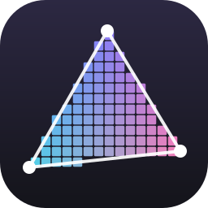
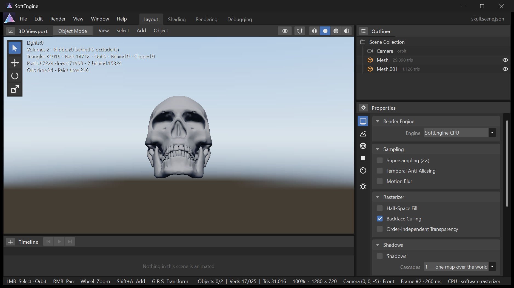
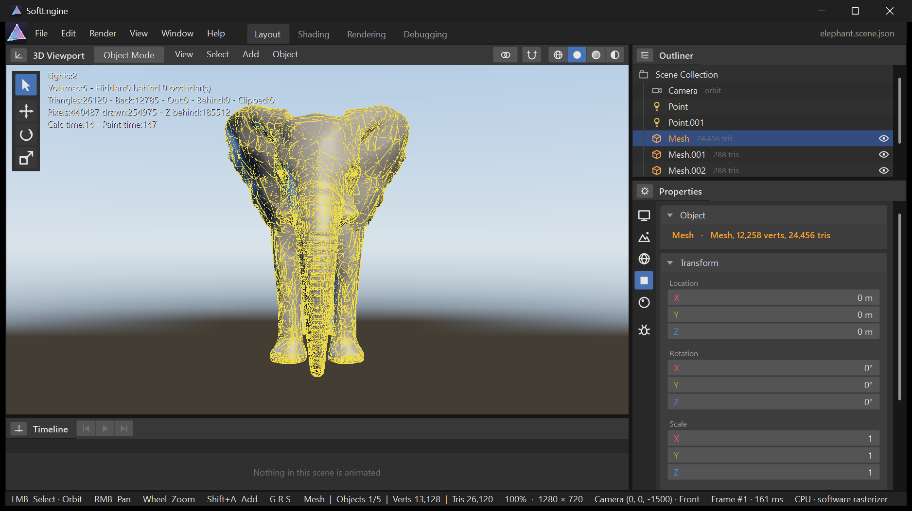
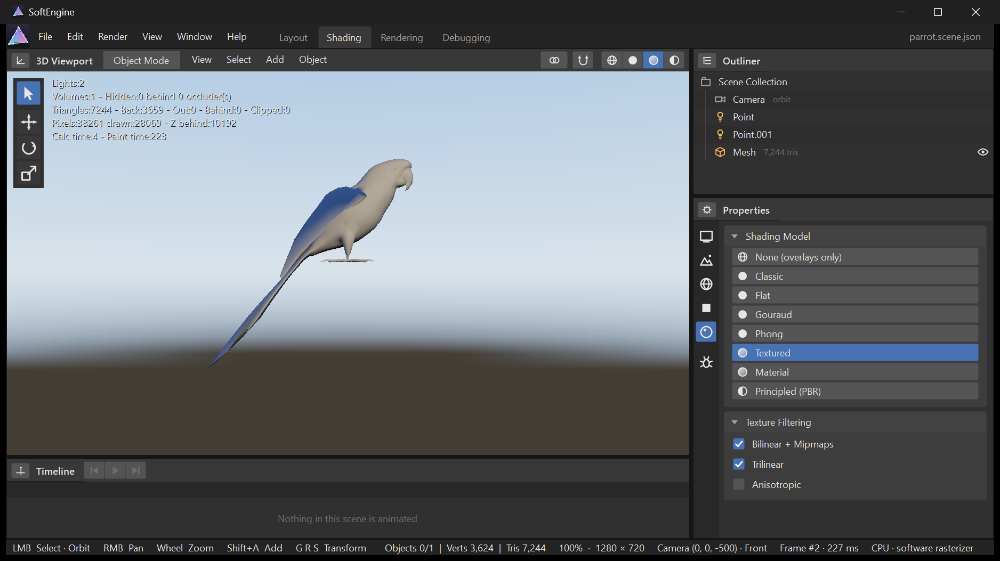
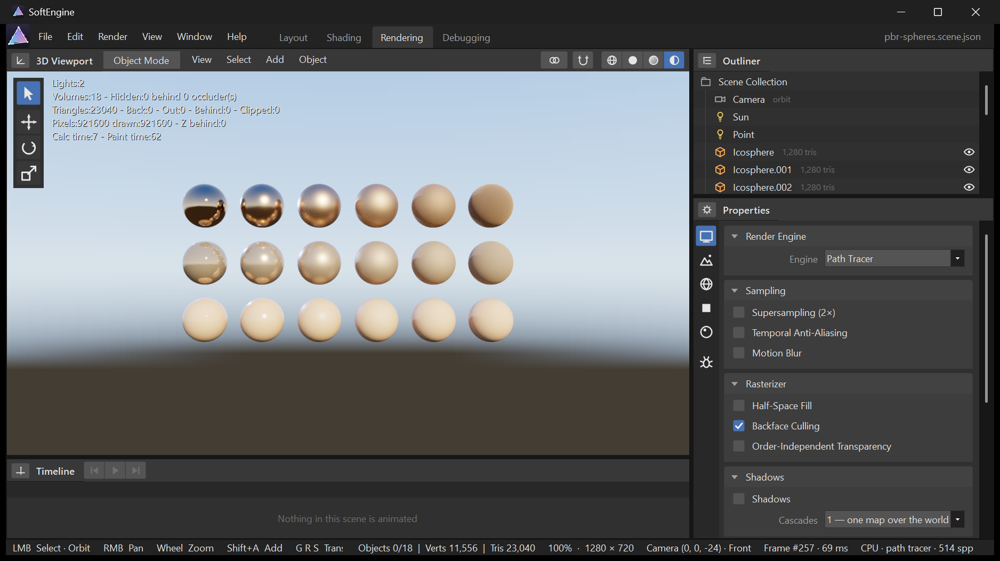
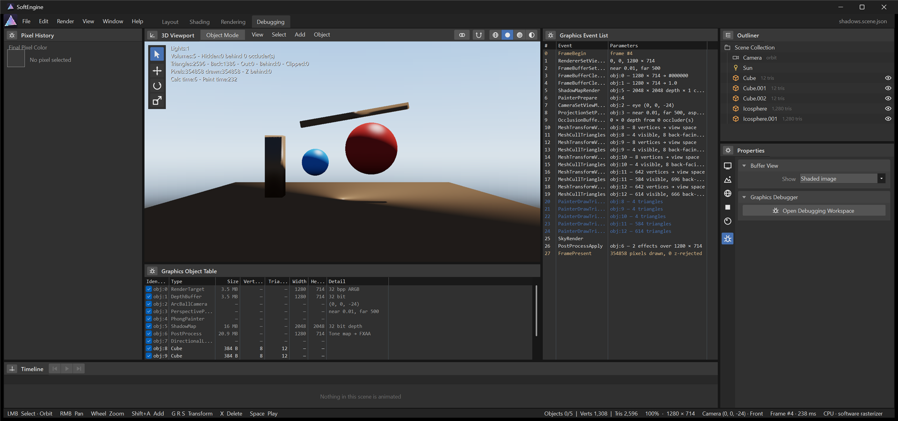
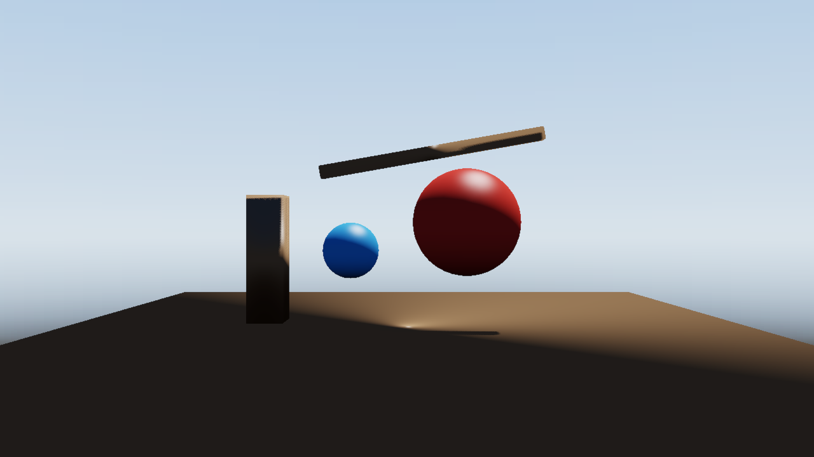
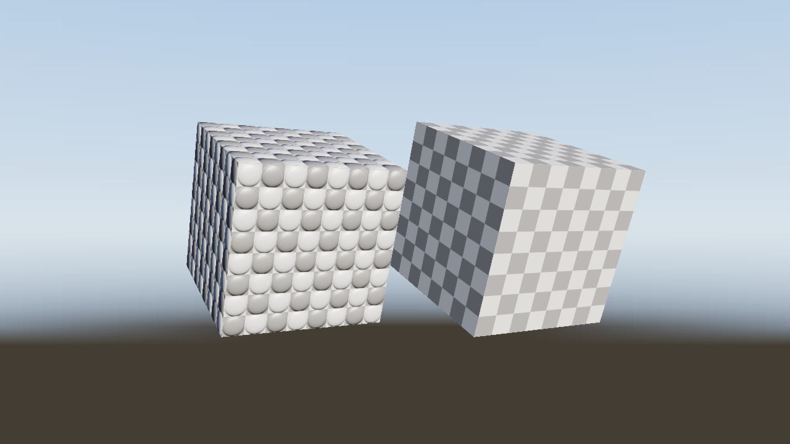
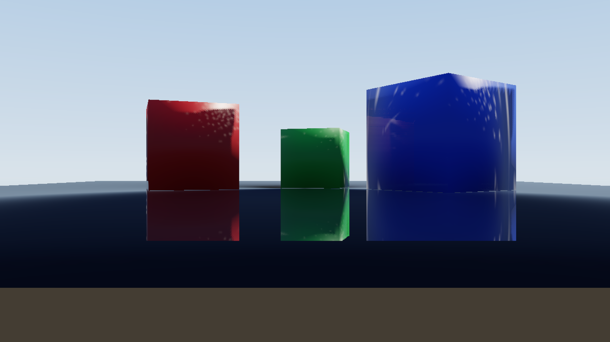

<p align="center">
  
</p>

# SoftEngine

[](https://github.com/HilthonTT/SoftEngine/actions/workflows/ci.yml)
[](https://github.com/HilthonTT/SoftEngine/actions/workflows/codeql.yml)
[](https://dotnet.microsoft.com/download)
[](LICENSE)

A **software 3D rasterizer** in C#. The whole pipeline — transforms, culling, clipping, scanline
rasterization, z-buffering and shading — runs on the CPU with no graphics-API dependency. A
Windows editor laid out like a desktop 3D suite — viewport, outliner, properties, timeline and
workspaces, with Blender's keys — renders live into a bitmap; a CLI renders headlessly to PNG; an
OpenGL backend can fill the same frame on a graphics adapter for comparison, and a path tracer can
render it as a reference.



|  |  |
| :--: | :--: |
| Elephant — 26k triangles, selected: its transform in the **Object** tab | Parrot in the **Shading** workspace |
|  |  |
| **Rendering** — the path tracer refining in the viewport | **Debugging** — pixel history, object table and event list |

> **[DESIGN.md](DESIGN.md)** is the companion to this file: why each part is built the way it is,
> what the trade-offs were, and the traps already paid for.

## What it does

- Loads `.obj`, `.dae` (Collada) and **glTF 2.0** `.gltf`/`.glb`, plus procedural primitives.
- Tiled, vectorized scanline fill with a z-buffer, hierarchical-Z and **occlusion culling**,
  or a **block-based half-space** fill over the same tiles.
- Eight shading modes from wireframe to **physically based** (Cook-Torrance metallic-roughness).
- Texture filtering up to **anisotropic**, which measures the two axes of a pixel's footprint
  apart so a floor seen edge-on stays sharp instead of blurring.
- Any number of coloured directional / point / spot lights, in an **HDR linear float target**.
- **Cascaded shadow maps**, SSAO, and an environment cube map as both skybox and ambient — loadable
  from a Radiance `.hdr` panorama that keeps its range.
- SSAO darkens **the ambient term alone**, from a per-pixel record of what ambient light contributed,
  so a face in full sun is not dimmed for standing near a corner.
- **Baked indirect light**: the path tracer measured into a grid of probes the rasterizer reads.
- **Screen-space reflections** of the local scene, over the environment reflection the shader
  already applies — tinted per channel, so a gold surface reflects a white wall as gold.
- Materials: albedo, normal, specular, metallic-roughness and emissive maps, plus **alpha cutouts**.
- **Refraction**: a transmissive material reads the frame behind it — thickness bends what it shows,
  roughness frosts it, and glTF's transmission, ior and volume extensions drive it.
- **Scene graph**, keyframed **animation** with clip **blending**, and linear-blend **skinning**.
- Post-process stack: bloom, tone mapping, FXAA, vignette. Supersampling, **TAA** and **motion blur**.
- Transparency sorted per triangle, or **order-independent** and resolved per pixel.
- **Scene editing**: ray-cast picking, drag gizmos and Blender-style keyboard transforms (G, R, S),
  an outliner, typed or dragged transforms, undoable.
- A **path-traced reference** with an a-trous **denoiser** guided by its own albedo, normals and
  depth, so a handful of paths per pixel is already an image you can read.
- **JSON scene files**, a **headless CLI** (stills and sequences), and a **graphics debugger** with
  buffer views and frame history.

|  |  |
| :--: | :--: |
| Shadow mapping | Normal mapping — only the left cube has a normal map |



*Screen-space reflections: the blocks are reflected in a polished floor, each in its own colour.*

## Build & run

```bash
dotnet build SoftEngine.slnx
dotnet run --project src/SoftEngine.WinForms                  # interactive viewer
dotnet test --project tests/SoftEngine.Core.Tests             # 973 tests
dotnet test --project tests/SoftEngine.WinForms.Tests         # 109 viewer tests, Windows only
dotnet run -c Release --project bench/SoftEngine.Benchmarks   # Release, or you measure the debugger
```

Requires the [.NET 11 SDK](https://dotnet.microsoft.com/download). Windows for the viewer;
`SoftEngine.Core` itself is platform-neutral. The GPU backend wants an OpenGL 3.3 driver and falls
back with a reason when there isn't one.

## Interactive app

The window is arranged like a desktop 3D suite, so it reads at a glance if you have used one:

- **Top bar** — File, Edit, Render, View, Window and Help menus, and the **workspace** tabs.
- **3D Viewport** — its header holds the mode, the View / Select / Add / Object menus, the overlay
  and snap toggles, and the **shading switch**: wireframe, solid, material preview, rendered. The
  **toolbar** down its left edge picks select, move, rotate or scale handles.
- **Outliner** — the scene as a tree: camera, lights, every mesh, with an eye to hide each. Click a
  row to select it; double-click to open its properties.
- **Properties** — tabs for **Render** (engine, sampling, rasterizer, shadows, post-processing,
  colour management), **Scene** (the loaded model, viewport overlays, animation), **World** (sky,
  panorama, baked light, mist), **Object** (location, rotation and scale — drag a field to scrub it,
  click to type — and visibility), **Material** (shading model, texture filtering) and **Debug**
  (buffer views).
- **Timeline** — play, pause, jump to either end, and scrub the loaded animation frame by frame.
- **Status bar** — what the mouse and keys do right now (during a G/R/S, what the gesture is doing),
  then the selection and the scene's object, vertex and triangle counts.

**Workspaces** (Ctrl+1 … Ctrl+4) rearrange the same window for a job: **Layout** is the plain editor,
**Shading** previews materials, **Rendering** hands the viewport to the path tracer (and gives it back
on the way out), **Debugging** opens the graphics debugger's panels around the viewport.

| Control | Action |
| --- | --- |
| **Left-drag / right-drag / wheel** | Orbit, pan (left+right dollies), move in and out |
| **W A S D / Q E** | Fly; **Shift** faster, **Ctrl** finer. The step scales with camera distance |
| **Numpad 1/3/7/9, 4/6/8/2** | Axis views and 15° turns, as close to Blender's as a Y-up world allows |
| **Left-click** | Probe the pixel *and* pick what is under it (**Esc** clears, **Tab** cycles) |
| **Shift+A** | Add a primitive — plane, cube, UV/ico sphere, cylinder, cone, torus |
| **G / R / S** | Move / turn / scale the selected mesh with the cursor; **X Y Z** constrain, click confirms, **Esc** cancels |
| **Alt+G / Alt+R / Alt+S** | Clear the selection's location / rotation / scale |
| **H / Alt+H** | Hide the selection / show everything hidden |
| **X** or **Del** | Delete the selected mesh |
| **Space**, **Shift+← / →** | Play or pause the animation; jump to its first / last frame |
| **N / T**, **Ctrl+Space** | Toggle the sidebar / the toolbar; maximize the viewport |
| **Ctrl+Z / Ctrl+Shift+Z** | Undo / redo (**Ctrl+Y** too); the Edit menu names the edit |
| **Ctrl+G** | Snap to a grid — whole units, 15°, tenths of scale |
| **Ctrl+S** | Save the scene as JSON (**File ▸ Open Scene…** brings it back) |
| **F12 / F11 / F1** | Render the viewport to a PNG / maximize the viewport / the full keyboard reference |

`G`, `R`, `S` and `X` act on the selection and only on it, so with nothing selected `S` still flies
the camera and `X` still turns the view. **Esc** deselects and hands them back.

There are about fifty bindings and only some are menu items, so **Help ▸ Keyboard and Mouse** (**F1**)
is the list — a control nobody can discover is a control nobody has.

**Dropping a file on the window** — or passing it on the command line, which is what Explorer's
*Open with* does — opens it by extension: `.obj`/`.dae`/`.gltf`/`.glb` as a model, `.json` as a
scene, `.hdr`/`.pic` and ordinary images as a panorama. **File ▸ Open Recent** keeps the last ten.
Window placement, the workspace, splitter positions, the recent list and the render engine live in
`%APPDATA%\SoftEngine\viewer.json` (or wherever `SOFTENGINE_VIEWER_SETTINGS` points); nothing in
there may throw, so a corrupt file means "use the defaults" and never a viewer that will not start.

```
SoftEngine.WinForms [file] [--workspace name] [--select n] [--time s] [--viewport WxH] [--screenshot out.png]
```

The options put the window into a known state from a script — a workspace, a selected mesh, a pose,
an exact viewport size — and `--screenshot` renders the viewport to a PNG and quits. Every image in
this README and in DESIGN.md is made that way, from the scene files in
[`docs/screenshots/scenes`](docs/screenshots/scenes): `pwsh docs/screenshots/capture.ps1` regenerates
them all.

**Render ▸ Render Engine** (or the engine field on the **Render** tab) picks CPU, GPU or path tracer. With nothing saved it opens on the CPU: the
viewer is a demonstration of a software rasterizer, and defaulting to the graphics card would quietly
show you something else.

On a laptop with two adapters, **Render ▸ Render Engine ▸ Graphics adapter** names them and picks
between them — the driver hands an application the integrated one unless it is told otherwise, which
is rarely what "render on the GPU" was meant to mean. The submenu appears only where there is a
choice, and the entries are the devices themselves rather than words about power:

> Automatic  ·  High performance — NVIDIA GeForce RTX 5060 Laptop GPU  ·  Power saving — Intel(R) Graphics

The driver's OpenGL is loaded once per session, so changing this once the viewport has been on the
GPU takes effect at the next launch, and the viewer says so rather than appearing to do nothing.

## Headless rendering

```bash
dotnet run -c Release --project src/SoftEngine.Cli -- model.gltf -o frame.png -w 1920 -h 1080 -p pbr --ss 2
```

| | |
| --- | --- |
| `-w`, `-h`, `--ss` | resolution and supersampling |
| `-p`, `--post`, `--view`, `--filter` | painter, post effects, buffer view, texture filtering |
| `--fill` | `scanline` (default) or `half-space` — how triangles are filled |
| `--yaw`, `--pitch`, `--zoom`, `--camera`, `-t` | where to stand, and how far into the animation |
| `--env`, `--environment-size`, `--hdr-sky` | light it with a panorama or the linear-light sky |
| `--shadows`, `--cascades` | shadow pass |
| `--oit` | resolve transparency per pixel instead of by sorting the triangles |
| `--bake`, `--bake-resolution`, `--bake-rays`, `--bake-bounces` | measure indirect light into probes first |
| `--trace`, `--samples`, `--bounces`, `--physical`, `--denoise` | path-trace instead of rasterizing |
| `--frames`, `--fps`, `--turntable`, `--shutter` | render a numbered sequence |
| `--backend`, `--gpu`, `--cpu`, `--adapter`, `--gpu-info` | where the frame is filled, and on which adapter |
| `--scene`, `--stats` | apply a saved scene; print counts and timings |

```bash
dotnet run -c Release --project src/SoftEngine.Cli -- parrot.dae --frames 30 --fps 30 --turntable 360 --shutter 0.5 -o turntable.png
ffmpeg -framerate 30 -i turntable.%04d.png -pix_fmt yuv420p turntable.mp4
```

`--frames <n>` writes `frame.0000.png`, … advancing the animation by `1/--fps` and sweeping the
camera `--turntable` degrees across the run — four zero-padded digits, because every tool that reads
a sequence sorts the names as text. The camera walks the arc rather than the model turning inside it,
since spinning geometry inside its own lighting looks like the lighting is spinning. Three further
differences from the viewer: the framing is **solved** (`r / sin(fov/2)`) rather than guessed; the
camera is a **bearing**, not an accumulated gesture, so the same three numbers give the same frame on
every machine; and textures decode from **PNG only** — a model with JPEG maps renders untextured and
the program says how many it skipped.

## Layout

```
src/
├── SoftEngine.Core/        # engine, no UI dependency (net11.0)
│   ├── Acceleration/       # world triangles flattened, and the SAH BVH over them
│   ├── Animation/          # tracks, interpolation, channels, clips, playback, blending
│   ├── Baking/             # the irradiance bake and what it is allowed to spend
│   ├── Buffers/            # FrameBuffer, velocity, fragments, refraction backdrop, pooled
│   │                       #   vertex/world buffers
│   ├── Diagnostics/        # stats, event log, pixel history, frame captures
│   ├── Editing/            # undoable edits and the history the tools record into
│   ├── Geometry/           # IMesh, Material, triangles, tangents — Import/ Primitives/
│   │                       #   Skinning/; Import/ holds OBJ, Collada and Gltf/
│   ├── Gizmos/             # grid, axes, skeleton, drag handles, modal transforms, snapping
│   ├── Imaging/            # PNG codec, Radiance .hdr reader
│   ├── Picking/            # ray, intersection, scene picker
│   ├── Pipeline/           # Renderer, clipping, sky — Culling/ Debugging/ PostProcess/
│   │                       #   Shadows/ Temporal/
│   ├── Rasterization/      # scanline and half-space fills, tiles, sampling — Painters/ Shaders/ Varyings/
│   ├── Scenes/             # world, camera, projections, lights — Graph/ Serialization/
│   ├── Shading/            # linear colour, light sets, ambient cube, GGX, BRDF LUT,
│   │                       #   the surface channel a shader reports per pixel
│   ├── Textures/           # Texture, filtering, cube maps, equirectangular, procedural sky
│   └── Tracing/            # path tracer, the integrator it shares with the bake, sampler,
│                           #   denoiser
├── SoftEngine.Gpu/         # OpenGL backend via Silk.NET, and Shaders/
├── SoftEngine.Cli/         # headless renderer (net11.0 console)
│   ├── Options/            # the flags, their parser, their bounds, the usage text
│   ├── Loading/            # model → world, panorama → cube map, PNG textures
│   └── Rendering/          # backend choice, framing, post chain, frames, report
└── SoftEngine.WinForms/    # the editor (net11.0-windows)
    ├── Controls/           # themed widgets, editor areas, outliner, properties, number
    │                       #   fields, timeline, workspace tabs, the icon glyphs
    ├── Demos/              # the bundled scenes and how a loaded world is framed
    ├── Debugging/          # pixel history, object table, event list
    ├── Dialogs/            # scene picker, keyboard reference, about
    └── MainScreen*.cs      # the window: layout, then one partial per concern

bench/SoftEngine.Benchmarks/   # headless frame-time harness
tests/SoftEngine.Core.Tests/   # xUnit suite in folders mirroring the engine, and Golden/
                               #   image baselines — which stay put, see DESIGN.md § Testing
tests/SoftEngine.WinForms.Tests/ # the viewer's window-free logic (net11.0-windows)
docs/screenshots/              # every image the docs show, the scenes they are rendered from,
                               #   and capture.ps1, which regenerates them
```

## Testing

`dotnet test --project tests/SoftEngine.Core.Tests` — **973 tests**. Alongside the unit tests, eighteen
generated scenes are rendered headless at 320×180 and compared against committed PNG baselines, so a
change that alters the picture shows up in the diff as a picture. `SOFTENGINE_UPDATE_GOLDEN=1` is the
only way to re-record one, and a failing run drops the actual frame and a diff image beside the
baseline. See [DESIGN.md § Testing](DESIGN.md#testing-and-benchmarks) for how the comparison is
weighted and why re-recording on failure is the thing not to do.

## Contributing

See [CONTRIBUTING.md](CONTRIBUTING.md). The short version: `dotnet format SoftEngine.slnx
--verify-no-changes`, `dotnet build`, `dotnet test`, and — because this is a renderer — say which
world and shading mode you looked at, with a screenshot for anything that changes the picture.

CI builds Debug and Release on Windows with warnings as errors, runs the tests, checks formatting
against [`.editorconfig`](.editorconfig), and uploads golden-image `.diff.png` artifacts when an
image test fails. If your change moves a golden baseline, re-record it deliberately
(`SOFTENGINE_UPDATE_GOLDEN=1 dotnet test`) and **say so in the pull request** — a silently updated
baseline is the one thing that makes that suite worthless.

Security reports go through [private advisories](SECURITY.md), not public issues. The file parsers
— glTF, Collada, OBJ, PNG, Radiance HDR — are where the real attack surface is, and each of them is
swept by a seeded mutation fuzzer that requires a broken file to fail as `InvalidDataException` or
`NotSupportedException` and nothing else. `SOFTENGINE_FUZZ_ROUNDS=200000 dotnet test` runs the long
version; see [DESIGN.md § Reading files nobody here wrote](DESIGN.md#reading-files-nobody-here-wrote).

## Credits

Started from David Rousset's
[*Learning how to write a 3D soft engine from scratch*](https://www.davrous.com/2013/06/13/tutorial-series-learning-how-to-write-a-3d-soft-engine-from-scratch-in-c-typescript-or-javascript/)
before growing its own pipeline, rasterizer and shading system.

The glTF demo models come from the Khronos
[glTF Sample Assets](https://github.com/KhronosGroup/glTF-Sample-Assets):

- **Fox**: model by PixelMannen ([CC0](https://creativecommons.org/publicdomain/zero/1.0/)); rigging
  and animation by tomkranis, glTF conversion by @AsoboStudio and @scurest
  ([CC BY 4.0](https://creativecommons.org/licenses/by/4.0/)).
- **Water bottle** (Microsoft) and **Lantern** (sbtron for Microsoft):
  [CC0](https://creativecommons.org/publicdomain/zero/1.0/).

## License

[MIT](LICENSE) © Hilthon
